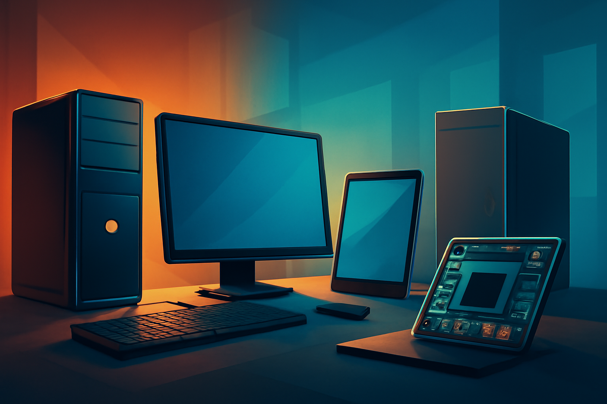

# Content Suite: Types of Computers: Hardware and Software

Topic: **Types of computers: hardware and software** · Tone: educational · Narration: Charon (excited)

## Summary

The article discusses the various types of computers—such as personal computers, workstations, servers, mainframes, and supercomputers—highlighting their distinct uses and hardware characteristics. It also explains the essential hardware components, like the CPU and memory, and the role of software, which includes system software and application software, in operating these devices. Understanding these concepts is vital for navigating today's digital landscape and recognizing the impact of technology on everyday life.

## Files

- Full article: [article.md](article.md)
- Summary: [summary.txt](summary.txt)
- Social posts: [social-posts.json](social-posts.json)
- Header image: [header.png](header.png)
- Thumbnail: [thumbnail.png](thumbnail.png)
- Narration of the summary: [narration.wav](narration.wav)
- Run details: [manifest.json](manifest.json)

## Social Posts

**twitter**

Explore the fascinating world of computers! From personal PCs to supercomputers, learn about their hardware, software, and how they shape our digital lives. Dive in now! #Computers #TechInsights

**linkedin**

Understanding the different types of computers—personal computers, workstations, servers, mainframes, and supercomputers—is crucial in today's tech-driven world. Our latest article breaks down their hardware features and the essential software that powers them. Equip yourself with knowledge that shapes our daily interactions with technology.

**instagram**

💻✨ Curious about computers? From sleek laptops to powerful supercomputers, there's so much to uncover! 🌐 Dive into our latest article and discover the different types of computers and their uses. Don't miss out! #Computers #TechSavvy #Hardware #Software #DigitalLife
